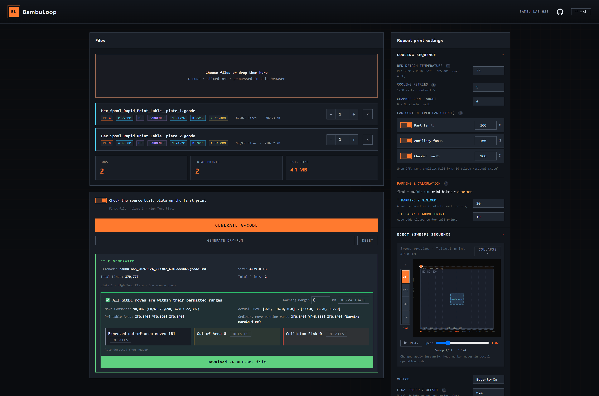

# BambuLoop
> 한국어 README: [README.ko.md](README.ko.md)

## BambuLoop is now supported in web version ([https://kiwinux.github.io/BambuLoop/](https://kiwinux.github.io/BambuLoop/))



<details>
<summary>Click here to show real printing demo GIF</summary>


</details>

### **BambuLoop is a web-based print farm tool for automated repeat printing on the Bambu Lab H2S.**

Print the same model (or several different ones) over and over — the printer
ejects each part by itself, no human intervention needed. BambuLoop combines
multiple sliced files into a single G-code that prints, cools, sweeps the
part off the bed with the nozzle head, and starts the next print —
automatically.

---

## How it works

```
[sliced model G-code] × N repeats
      ↓
  PRINT → COOL → EJECT (nozzle sweep) → REHEAT → PURGE → next PRINT
      |                                                       ↓
      └───────────────────── repeat ──────────────────────────┘
```

No extra hardware required. The nozzle head itself pushes finished parts
off the bed.

---

## Recommended build plate

For automatic ejection to work reliably, a **cold-release** build plate is
recommended.

**[CryoNix Cold Build Plate](https://aliexpress.com/item/1005009240815983.html)** is recommended:

- Smooth PUR coating — parts release on their own as the bed cools
- No tilting or scraping needed — the nozzle just gently nudges the part off
- Supports both low-temp (PLA 25–45°C) and normal printing

Bambu's stock gold textured PEI plate also works, but requires lower
cooling temperatures and stronger eject force.

> Not an affiliate link — just a personal recommendation based on direct
> use.

---

## Run in a browser

BambuLoop opens sliced files, generates G-code and validates downloads in a Web Worker. The ready-to-serve GitHub Pages files are in `docs/`. The first processing operation loads about 13 MiB of bundled WebAssembly and Python runtime assets from the same site. Users do not need a Python installation, Flask or an account. Files stay in the tab; closing it clears the working files.

For a local preview, run `node tools/preview.mjs` from the repository and open [BambuLoop on localhost](http://127.0.0.1:4173/BambuLoop/). Any static HTTP(S) server can serve `docs/`. Its runtime, engine and presets must remain in their supplied subdirectories. The tab uses a 200 MiB budget for stored inputs (including extracted plates), an expanded archive and the estimated combined G-code. If only the expanded output 3MF exceeds the budget, the combined G-code is offered for download. Available device memory also affects large jobs.

The optional local HTTP API uses Python 3.10+. Install `requirements.txt` and run `python app.py` to serve the same UI and the existing `/api/` endpoints on loopback port 5000.

### Publish on GitHub Pages

On a push to `main`, the **Deploy BambuLoop to GitHub Pages** workflow rebuilds the shared engine bundle and publishes only `docs/`.

## Quick start

### 1. Open the site and select sliced files

Slice in **Bambu Studio** and export via:

- **Plate → Export plate sliced file as 3MF** → `.gcode.3mf`

Drag the `.gcode.3mf` file into the BambuLoop browser UI. You can drop
multiple files at once.

### 2. Set repeat count

Set how many times each model should be printed.

### 3. Pick eject method

The default `edge_to_center` works well in most cases. For short prints
__**(only when under 42 mm tall)**__, try `bottom_only` or
`edge_to_center_bottom` — these concentrate the eject force closer to
the bed.

### 4. Generate a dry-run file

The Dry-Run test generates a G-code that runs only the automation
sequence (cool → eject → reheat → reset) without actually printing.

The validation panel reports the checked moves and any out-of-path motion.

### 5. Generate and download

Click **Generate**. Download the resulting `.gcode.3mf` (or `.gcode`).

The browser saves a file. You can inspect the downloaded result in Bambu Studio.

---

## Tips for the first run

- If this is your first time using BambuLoop, **start with a small repeat
  count** (e.g. 3) to confirm parts release cleanly from the build plate.
- **Watch the first full cycle in person** before walking away.

---

## Configuration

The right-side panel has all settings. Sensible defaults are already in
place and ready to use.

Hover any ⓘ icon for an inline explanation.

Settings you'll commonly tweak:

| Setting              | What it does                                          |
| -------------------- | ----------------------------------------------------- |
| Cooling bed temp     | Target bed temp before eject (CryoNix: ~37°C, PEI: ~35°C) |
| Eject method         | Sweep pattern (see in-app preview)                    |
| Eject passes         | Number of X-axis sweeps                               |
| Z descent steps      | How many Z levels to step down through                |
| Pause after eject    | Pause between prints (for manual verification)        |
| Sound events         | Play melodies on print done / cool done / restart     |

---

## Safety notes

⚠️ **BambuLoop is unofficial software and not affiliated with BambuLab.**

- BambuLoop has its own safety checks (Z-collision validation, multi-model
  compatibility check, per-command G-code simulation). Even so, **always
  run a dry-run on an empty bed first** whenever you use a new
  configuration.
- **Check the source build plate on the first print** is enabled by default. The first job’s selected 3MF plate supplies the build surface and its sliced startup check. An existing check is kept once at startup. Clearing the box omits it from combined and dry-run files. A source without a check adds none. The printer’s own detection flag still applies.
- The generator and dry-run use the same eject clearance check. Bottom-fixed sweeps require a print under **42 mm**. For stepped sweeps the drop per step must be at most 42 mm. Files with no usable print height can still be combined with ejection disabled.
- The default **20 mm purge margin** applies only to recognised H2S nozzle priming and purge-bin exit paths. Enter 0 to check those paths against the bed edge. Ordinary print moves use the printable area. Eject sweeps are checked separately against the generated path and the project's reference Y range of −5 to 335 mm. These bounds describe the software checks.
- Layer numbers continue across models and copies. Rechecking a generated 3MF follows the first job’s source plate number and displays the inspected entry.
- Don't leave the printer unattended during your first repeat-print
  session. Watch at least one full cycle before stepping away.
- If a print fails to release, the next eject sweep will collide with it.
  This is the most common failure mode, and using a CryoNix plate greatly
  reduces the risk.
- The developer accepts no responsibility for any issues arising from
  the use of BambuLoop.

---

## UI language

The interface supports **Korean** and **English** — switch anytime with
the language button at the top of the page.

---

## Roadmap / Contributing

Features planned for future versions:

- **Support for other Bambu printers** (H2D·H2C·H3C·X1C·P1S·A1) — requires checking the available head travel range and printer-specific G-code commands
- **Additional UI languages** (Chinese, etc.)
- **Per-model AMS filament override** — currently the first model's AMS
  setting applies to every model
- **Web UI improvements** — drag-to-reorder jobs, save/load configuration
  presets

Bug reports, translations, and PRs are all welcome. See
[CONTRIBUTING.md](CONTRIBUTING.md) for the workflow. Contributions of any
kind are appreciated :)

Adding a new UI language is currently the easiest way to contribute —
just add a single `i18n/<lang>.json` file. See
[`i18n/README.md`](i18n/README.md).

---

## License

MIT — see [LICENSE](LICENSE).
Copyright (c) 2026 [@kiwinux](https://github.com/kiwinux)
